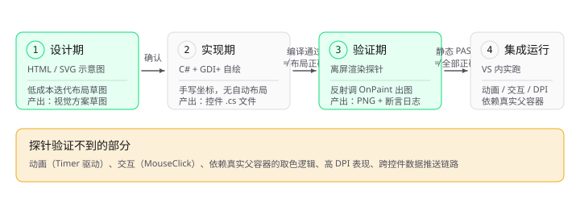
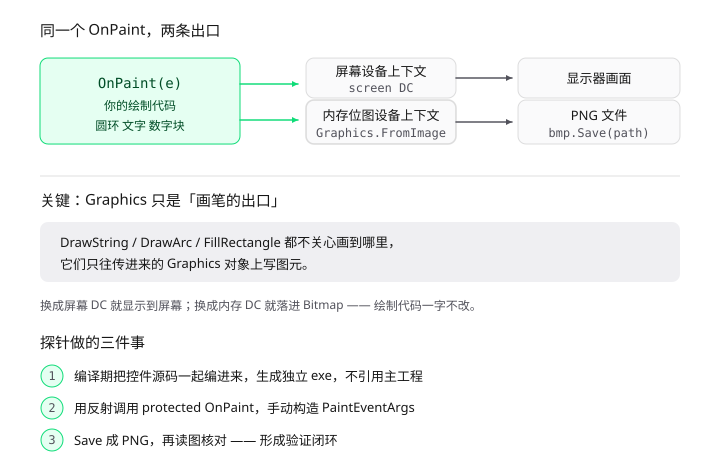

# 自绘控件 UI 验证方法论

> 面向 WinForms / .NET Framework 自绘控件（`Control` + `OnPaint` + GDI+）的界面验证流程。
> 解决一个具体问题：**自绘控件的布局对不对，肉眼判断不可靠，必须用可量化的方式验证。**
>
> 案例来源：A205 自动测试系统 `UI\TestProgressPanel.cs`（449×153 测试进度面板）的开发全过程。

---

## 为什么要写这份文档

自绘控件和普通控件最大的区别是：**没有 AutoSize、没有 Dock 自动布局、没有设计器预览**。所有位置都是手写的 `DrawString(x, y)` 和 `DrawRectangle(rect)`，写错了编译器不会报错，运行时也只是"看起来有点歪"。

本案例中，三个真实缺陷全部是靠肉眼在截图上发现的，而不是靠调试器：

| 缺陷 | 表面现象 | 真实原因 |
|---|---|---|
| 圆环与标题重叠 | 圆环顶部压在"测试进度"四字上 | 环按中心线直径 72px 定位，描边宽 9px，实际外缘 81px，比预期大 9px |
| 底部文字被裁 | "频段108"下缘缺一小截 | 页脚文字占 y 136–152，控件高 153，仅剩 1px 余量，字形墨迹超出 `Font.Height` |
| 两行文字不居中 | 百分比偏上、分数偏下且偏右 | `DrawString` 的 x/y 是**外接框左上角**，不是视觉中心 |

这三次修复的共同教训：**凭直觉估算坐标必然出错，必须实测字体度量并做数值化断言。**

---

## 整体流程



文字版流程：

```
阶段一 · 设计期（HTML/SVG 示意图）
  目的：低成本迭代视觉方案，用户确认后再写代码
  产出：布局草图、三态对比图
  ↓ 用户确认视觉方案
阶段二 · 实现期（C# + GDI+）
  目的：把手绘方案变成可编译的自绘控件
  产出：TestProgressPanel.cs
  ↓ 编译通过 ≠ 布局正确
阶段三 · 验证期（离屏渲染探针）
  目的：不启动 VS、不连仪器，拿到控件真实绘制结果并量化核对
  产出：PNG 截图 + 坐标断言日志
  ↓ 静态绘制全部 PASS
阶段四 · 集成运行（VS 内实际运行）
  目的：验证探针覆盖不到的部分（动画、交互、依赖真实父容器的逻辑）
```

**关键认知：编译通过不等于布局正确，探针通过也不等于控件没问题。** 阶段三只能验证静态绘制结果。

---

## 阶段一：HTML/SVG 示意图

### 作用

在写任何 C# 代码之前，先用 HTML 画出布局草图。它的最大价值是**迭代成本极低**——改一行 `viewBox` 坐标秒出图，而改 C# 布局常量要重新编译、重新截图。

同时它是**沟通载体**：把"我打算做成这样"以可视形式交给用户确认，避免写完 400 行 GDI+ 代码后才发现方向不对。

### 写法 A：独立可复现版（推荐，脱离 Trae 也能用）

单文件 HTML，保存后用浏览器直接打开。关键要点：

- **用 `viewBox` 等比缩放**：SVG 内部坐标写死（如 `0 0 449 165`），靠 `width:100%; height:auto` 缩放。这样同一份图能同时表达设计尺寸和展示尺寸
- **用 CSS 变量承载配色**：换肤、light/dark 适配只改变量，不动图形坐标
- **必须支持 dark 模式**：`@media (prefers-color-scheme: dark)` 或容器查询，避免只在浅色下好看
- **标注关键坐标**：把 Designer 里的真实 `Location` / `Size` 写进图里，便于和代码对照

```html
<!DOCTYPE html>
<html lang="zh-CN">
<head>
<meta charset="utf-8">
<title>控件布局稿 449×153</title>
<style>
:root {
  color-scheme: light;
  --surface: #FAFAFB;
  --block-fill: #F3F3F6;
  --border: rgba(23,23,23,.12);
  --text: #2D2D34;
  --text-muted: #7A7A84;
  --brand: #009650;
  --track: #D6EEE0;
  --fail: #C53026;
  --pass-text: #008A44;
}
@media (prefers-color-scheme: dark) {
  :root {
    color-scheme: dark;
    --surface: #1A1A1A;
    --block-fill: #262626;
    --border: rgba(229,229,229,.14);
    --text: #E5E5E5;
    --text-muted: #A1A1AA;
    --brand: #32F08C;
    --track: #143524;
    --fail: #E8463A;
    --pass-text: #4ADE80;
  }
}
body { margin:0; padding:24px; background:var(--surface); font-family:"PingFang SC","Microsoft YaHei",system-ui,sans-serif; }
figcaption { font-size:13px; color:var(--text-muted); margin-top:10px; text-align:center; }
svg { display:block; width:100%; height:auto; max-width:449px; margin:0 auto; }
</style>
</head>
<body>
<figure>
  <svg viewBox="0 0 449 153" role="img" aria-label="测试进度控件布局稿">
    <!-- 卡片底 -->
    <rect x=".5" y=".5" width="448" height="152" rx="12"
          fill="var(--surface)" stroke="var(--border)"/>

    <!-- 标题 -->
    <text x="14" y="25" fill="var(--text)"
          style="font:700 15px 'Microsoft YaHei',sans-serif">测试进度</text>

    <!-- 状态徽章 -->
    <rect x="363" y="7" width="72" height="20" rx="10" fill="#E2F6EB"/>
    <circle cx="375" cy="17" r="3.5" fill="var(--brand)"/>
    <text x="384" y="22" fill="var(--pass-text)"
          style="font:500 12px 'Microsoft YaHei',sans-serif">运行中</text>

    <!-- 进度环：外缘 81px，描边 9px，中心线直径 72px -->
    <circle cx="54.5" cy="79.5" r="36" fill="none"
            stroke="var(--track)" stroke-width="9"/>
    <circle cx="54.5" cy="79.5" r="36" fill="none"
            stroke="var(--brand)" stroke-width="9" stroke-linecap="round"
            stroke-dasharray="145 226" transform="rotate(-90 54.5 79.5)"/>
    <text x="54.5" y="85" text-anchor="middle" fill="var(--fail)"
          style="font:700 22px Consolas,monospace">64%</text>

    <!-- 数字块 2×2 -->
    <rect x="100" y="32" width="163" height="42" rx="8" fill="var(--block-fill)"/>
    <text x="110" y="52" fill="var(--text-muted)"
          style="font:400 12px 'Microsoft YaHei',sans-serif">总项数</text>
    <text x="110" y="69" fill="var(--text)"
          style="font:700 15px Consolas,monospace">14</text>
    <!-- 其余三块同理 -->

    <!-- 页脚 -->
    <line x1="14" y1="131" x2="435" y2="131" stroke="var(--border)"/>
    <text x="14" y="146" fill="var(--text-muted)"
          style="font:400 12px 'Microsoft YaHei',sans-serif">当前项</text>
    <text x="66" y="146" fill="var(--text)"
          style="font:400 12px 'Microsoft YaHei',sans-serif">线性最大增益 频段108 CH1</text>
  </svg>
  <figcaption>449×153 · 环外缘 81px 与上方 GroupBox 同宽对齐</figcaption>
</figure>
</body>
</html>
```

### 写法 B：Trae 工具调用版（对话内直接渲染）

在 Trae 中可以用 `dynamic-ui` 技能 + `PureShowWidget` 工具把图直接渲染在对话里，好处是**你不需要打开任何文件就能看到效果**，改代码后刷新即可看到新图。

调用要点：

- `title` 用 snake_case 且具体（如 `test_progress_panel_layout_449x165`），不要用 `chart`、`diagram` 这类通用名，方便日后引用
- 输出顺序固定 `<style>` → 内容 → `<script>`（需要交互时才加）
- CSS 变量定义在 `<style>` 开头，先给 light 默认值，再用 `:root[data-widget-theme="dark"]` 覆盖
- 不要有 `<!DOCTYPE>` / `<html>` / `<head>` / `<body>`，根元素带 `data-dynamic-ui-widget`

局限：**该方式依赖 Trae 环境，脱离 Trae 不可用**。若文档要通用，写法 A 更稳妥。

### 阶段一的局限（必须写进文档）

HTML 示意图与最终 GDI+ 绘制**必然存在偏差**：

| 差异来源 | 影响 |
|---|---|
| 字体不同 | HTML 用浏览器字体栈，GDI+ 用系统安装的字体，度量完全不同 |
| 渲染引擎不同 | 浏览器用 Skia，GDI+ 用其自己的栅格化，抗锯齿、字形墨迹范围都有差异 |
| 环境光不同 | HTML 有 light/dark，GDI+ 只有单一底色 |
| 文本换行不同 | HTML 自动换行，GDI+ 需手动 `MeasureString` 截断 |

**结论：示意图只用于确认"视觉方案对不对"，绝不用于确认"布局坐标对不对"。后者必须靠阶段三。**

---

## 阶段二：实现期（C# + GDI+ 自绘控件）

### 控件骨架

沿用项目已有的自绘控件写法（如 `SignalFlowPanel`）：

```csharp
public class TestProgressPanel : Control
{
    public TestProgressPanel()
    {
        SetStyle(
            ControlStyles.AllPaintingInWmPaint
            | ControlStyles.UserPaint
            | ControlStyles.OptimizedDoubleBuffer
            | ControlStyles.ResizeRedraw,
            true);
        // 不透明底色，与父容器一致。
        // 原因：TabPage 在 UseVisualStyleBackColor = true 时使用视觉样式渲染，
        //       不支持子控件透明背景，否则渲染为纯黑。
        BackColor = Color.White;
        TabStop = false;   // 自绘控件不参与 Tab 导航
    }
}
```

### 关键原则 1：布局预算必须闭合

**先算纵向预算，再写代码。** 把高度分配写成注释，贴在常量区：

```csharp
// 纵向预算（153px 全高）：
//   标题行    6 .. 25     （10.5pt 粗体行高 19px）
//   内容区   32 .. 121    （进度环与 2×2 数字块并排）
//   分隔线   127
//   页脚行   130 .. 146   （9pt 行高 16px，底部留 7px 余量）
private const float TitleTop = 6f;
private const float BlockTop = 32f;
private const float BlockHeight = 42f;
private const float BlockGap = 5f;
private const float FooterZone = 26f;
```

写完后立即做加法核对：`6 + 19 = 25`，`25 + 7 = 32`，`32 + 42 + 5 + 42 = 121`，`121 + 6 = 127`，`127 + 3 + 16 = 146`，`146 + 7 = 153`。每一处间隙都是显式设计，不是"差不多就行"。

### 关键原则 2：圆环用外缘直径定位

本案例最大的一个坑。`Graphics.DrawArc(pen, rect, ...)` 的 `rect` 指的是**中心线**的包围矩形，不是外缘。

```csharp
// 错误：以为 72px 是外缘，实际外缘 = 72 + 9 = 81px，顶部多出 9px 压住标题
float centerLine = 72f;

// 正确：显式区分三个直径
float outer      = 81f;              // 外缘（视觉边界）
float thickness  = 9f;               // 描边宽
float centerLine = outer - thickness; // 72px：DrawArc 的 rect 用这个
float innerDiameter = centerLine - thickness; // 63px：文字可用区域
```

### 关键原则 3：文字必须用 StringFormat 居中，不能用坐标

**这是最容易踩的坑，且无法靠肉眼可靠判断。**

`DrawString(text, font, brush, x, y)` 的 `x`/`y` 是**文字外接框的左上角**，不是视觉中心。字体的 ascent/descent 不对称（微软雅黑的 descent 比 ascent 大；Consolas 数字是等高字形、无降部），所以"按行高算中心"必然偏移，且偏移量随字体和字号变化——**不存在一个固定值能同时让两行都居中**。

正确做法是分配矩形区，交给 `StringFormat` 居中：

```csharp
private void DrawCenteredText(Graphics g, string text, Font font, Color color,
    float centerX, float centerY, float regionSize)
{
    float half = regionSize / 2f;
    RectangleF region = new RectangleF(centerX - half, centerY - half, regionSize, regionSize);

    using (SolidBrush brush = new SolidBrush(color))
    using (StringFormat format = new StringFormat
    {
        Alignment = StringAlignment.Center,        // 水平居中
        LineAlignment = StringAlignment.Center,    // 垂直居中
        FormatFlags = StringFormatFlags.NoWrap,
        Trimming = StringTrimming.None
    })
    {
        g.DrawString(text, font, brush, region, format);
    }
}
```

如果还需要微调（比如补偿数字字形偏上），加一个命名常量并记录原因：

```csharp
// 2px 下移：Consolas 粗体数字为等高字形，墨迹重心偏上，补偿其视觉偏移。
DrawCenteredText(g, FormatPercent(ratio), _metricFont, color, cx, cy + 2f, innerDiameter);
```

### 关键原则 4：先测字体度量，再定尺寸

**不要凭直觉估算文本宽度。** 实测：

```csharp
var metricFont = new Font("Consolas", 16F, FontStyle.Bold);
float h = metricFont.Height;   // 25px
float w = g.MeasureString("100%", metricFont, PointF.Empty,
    StringFormat.GenericTypographic).Width;   // 46.9px
```

常见行高参考（.NET Framework 4.8，96 DPI）：

| 字体 | 行高 |
|---|---|
| 微软雅黑 8.5pt | 15px |
| 微软雅黑 9pt | 16px |
| 微软雅黑 10.5pt Bold | 19px |
| Consolas 13pt Bold | 21px |
| Consolas 16pt Bold | 25px |

**决策依据示例**：内圈净空 63px，"100%" 宽 46.9px，两侧各留 16px 余量 → 16pt 安全。13pt 只留 27px，偏小。

### 关键原则 5：装不下就留白，不要裁字

```csharp
// 数字块高度固定为设计值，不随可用高度压缩。
// 内容区装不下两行时直接不画（宁可留白也不裁字）。
float contentHeight = Height - BlockTop - FooterZone;
if (contentHeight < BlockHeight * 2f + BlockGap)
{
    return;
}
```

这是从"高度被压缩时文字溢出压到分隔线上"这个缺陷学来的。压缩字号看似灵活，实则必然裁字。

### 关键原则 6：超长文本必须截断

```csharp
string text = _currentItem;
SizeF size = g.MeasureString(text, _bodyFont);
float maxWidth = Width - 66f - 14f;
if (size.Width > maxWidth)
{
    while (text.Length > 1 && g.MeasureString(text + "..", _bodyFont).Width > maxWidth)
    {
        text = text.Substring(0, text.Length - 1);
    }
    text = text + "..";
}
```

---

## 阶段三：离屏渲染探针（核心）

### 技术原理

GDI+ 的绘制函数（`DrawString` / `DrawArc` / `FillRectangle`）**不关心自己画到哪里去**，只往传入的 `Graphics` 对象上写图元。而 `Graphics` 可以包在两种东西上：

- **屏幕设备上下文** —— 画完显示到显示器
- **内存位图设备上下文** —— `Graphics.FromImage(bmp)`，画的全部落在内存像素数组里

所以**同一个 `OnPaint` 方法，配上不同来源的 `Graphics`，就得到屏幕输出或图片输出。** 探针里的绘制代码与你实际运行的代码完全一致——这是它可信的根本原因。



上图对应关系：

| 图中元素 | 代码中的实体 |
|---|---|
| 屏幕设备上下文 | 控件在窗体上的正常绘制环境 |
| 内存位图设备上下文 | `Graphics.FromImage(bmp)` |
| 圆环 / 文字 / 数字块 | `DrawArc` / `DrawString` / `FillRectangle` |
| 显示器画面 | 正常运行时的窗口 |
| PNG 文件 | 探针出图，用 `bmp.Save(path)` 落盘 |

### 目录位置

放在 `obj\` 下，**不要放在项目根目录或 `UI\` 下**：

- `obj\` 是 MSBuild 中间产物目录，不会被当作源码提交
- 不会被加入 `csproj` 的 `<Compile Include>`，编译主工程时完全看不见它
- 每次验证完可直接删除

```
obj\probe\Render.cs        ← 探针源码
obj\probe\render.exe       ← 编译产物
obj\probe\*.png            ← 渲染结果
obj\probe\log.txt          ← 数值断言结果
```

### 探针源码模板

```csharp
using System;
using System.Drawing;
using System.Drawing.Drawing2D;
using System.Drawing.Imaging;
using System.IO;
using System.Reflection;
using System.Text;
using System.Windows.Forms;

internal static class Render
{
    [STAThread]
    private static void Main()
    {
        var log = new StringBuilder();
        try
        {
            Application.EnableVisualStyles();
            Application.SetCompatibleTextRenderingDefault(false);

            // ========== 阶段 A：数值化断言（不需要出图）==========
            AssertLayout(log);

            // ========== 阶段 B：渲染出图 ==========
            Shot(449, 153, "s_0.png",   19, 0,  0,  "线性最大增益 频段108 CH1");
            Shot(449, 153, "s_64.png",  14, 9,  12, "线性最大增益 频段108 CH1");
            Shot(449, 153, "s_100.png", 14, 14, 12, "带内虚假信号 频段108 CH1");
        }
        catch (Exception ex)
        {
            log.AppendLine("EXCEPTION: " + ex.GetType().FullName);
            log.AppendLine(ex.Message);
        }
        File.WriteAllText(@"obj\probe\log.txt", log.ToString());
    }

    /// <summary>
    /// 渲染：用反射调用 protected OnPaint，把绘制结果导向内存位图。
    /// </summary>
    private static void Shot(int w, int h, string name,
        int total, int done, int passed, string item)
    {
        var panel = new A205AutoTestSystem.UI.TestProgressPanel { Size = new Size(w, h) };
        panel.PushProgress(
            A205AutoTestSystem.UI.TestProgressPanel.ProgressState.Running,
            total, done, passed, 0, TimeSpan.FromSeconds(222), item);

        using (var bmp = new Bitmap(w, h))
        using (var g = Graphics.FromImage(bmp))
        {
            g.SmoothingMode = SmoothingMode.AntiAlias;
            g.TextRenderingHint = System.Drawing.Text.TextRenderingHint.ClearTypeGridFit;

            // OnPaint 是 protected，外部拿不到，用反射取
            MethodInfo onPaint = typeof(Control).GetMethod("OnPaint",
                BindingFlags.Instance | BindingFlags.NonPublic);
            onPaint.Invoke(panel, new object[]
            {
                new PaintEventArgs(g, new Rectangle(0, 0, w, h))
            });

            bmp.Save(@"obj\probe\" + name, ImageFormat.Png);
        }
    }

    private static void AssertLayout(StringBuilder log) { /* 见下节 */ }
}
```

### 为什么用反射调 OnPaint，而不是 DrawToBitmap

`Control.DrawToBitmap(bmp, rect)` 是公开 API，写起来简单，但它**对自绘控件不可靠**。

它的实现是给控件发送 `WM_PRINT` 消息让窗口自行重绘。对 `UserPaint` 控件（尤其是项目自绘面板）效果不可靠——本案例中截出来的图**环变成椭圆、文字被拉伸**，当时一度误判为布局问题。

**换成直接调 `OnPaint` 后画面完全正常。**

> 教训：验证自绘控件的绘制结果，`DrawToBitmap` 不可靠，反射调 `OnPaint` 才是准确手段。

### 编译与运行命令

`TestProgressPanel` 只依赖 `System.Drawing` 和 `System.Windows.Forms`，**不依赖主工程**，所以可以完全独立编译：

```powershell
& "C:\Windows\Microsoft.NET\Framework64\v4.0.30319\csc.exe" `
  /target:exe /out:"obj\probe\render.exe" `
  /r:System.dll /r:System.Drawing.dll /r:System.Windows.Forms.dll `
  "UI\TestProgressPanel.cs" "obj\probe\Render.cs"

& "obj\probe\render.exe"
Get-Content "obj\probe\log.txt"
```

**注意**：如果控件引用了项目内的其他类型（如 `InstrumentLinkState` 枚举），有两种处理：

1. 把那个类型也列进编译命令（源文件方式）
2. 引用主工程 exe：`/reference:"bin\Debug\A205自动测试系统.exe"` ——但这样运行时 exe 与探针必须同目录，且会加载主工程的依赖 DLL，容易踩到版本冲突

**优先用第 1 种**，保持探针独立。

### 阶段 C：数值化断言（本方法论的核心）

**只出图是不够的。** 出图只能发现"看起来不对"，但无法量化验证，也无法在多档尺寸下批量回归。

必须把布局常量当作输入，计算出每个元素的**实际占位区间**，然后断言区间之间不重叠、不越界：

```csharp
private static void AssertLayout(StringBuilder log)
{
    var metricFont = new Font("Consolas", 16F, FontStyle.Bold);
    var bodyFont   = new Font("微软雅黑", 9F);
    var titleFont  = new Font("微软雅黑", 10.5F, FontStyle.Bold);

    const float TitleTop = 6f, BlockTop = 32f, FooterZone = 26f;
    const float RingOuterDesign = 81f, ThicknessDesign = 9f;
    const float BlockHeight = 42f, BlockGap = 5f;

    foreach (int h in new[] { 153, 145, 140, 130, 118, 100 })
    {
        log.AppendLine("=== height " + h + " ===");

        // 各元素占位区间
        double titleBottom = TitleTop + titleFont.Height;
        double contentHeight = h - BlockTop - FooterZone;
        double outer = Math.Min(RingOuterDesign, contentHeight);
        double cy = BlockTop + contentHeight / 2.0;
        double ringTop = cy - outer / 2.0;
        double ringBottom = cy + outer / 2.0;
        double blocksBottom = BlockTop + BlockHeight * 2 + BlockGap;
        double dividerY = h - FooterZone;
        double footerBottom = dividerY + 3 + bodyFont.Height;

        log.AppendLine(" title " + TitleTop + ".." + titleBottom);
        log.AppendLine(" ring  " + ringTop + ".." + ringBottom
            + "  gapTitle=" + (ringTop - titleBottom));
        log.AppendLine(" blocks " + BlockTop + ".." + blocksBottom);
        log.AppendLine(" divider=" + dividerY + " footer bottom=" + footerBottom);
        log.AppendLine(" bottomMargin=" + (h - footerBottom));

        // 断言
        bool ok = ringTop >= titleBottom          // 环不压标题
            && footerBottom <= h                    // 文字不被裁
            && dividerY >= blocksBottom             // 块不压分隔线
            && (blocksBottom <= dividerY);          // 顺序正确
        log.AppendLine(" => " + (ok ? "PASS" : "FAIL"));
    }
}
```

**要点：断言要覆盖多档高度。** 本案例最初只测 153px（设计尺寸），但后来发现 140px / 118px 下数字块会溢出压到分隔线——这是**在修完第一个缺陷后才暴露的第二个缺陷**。把 153/145/140/130/118/100 都跑一遍，才能确认降级行为正确。

### 阶段 D：读取并核对图片

断言通过后，**仍要人眼看一遍 PNG**。断言能验证"不重叠、不越界"，但验证不了"好不好看"。

给 AI 或人核对时的检查清单：

- [ ] 文字有无被裁切（下缘缺失是高频问题）
- [ ] 元素有无重叠
- [ ] 圆环是否正圆（`DrawArc` 的 rect 必须是正方形）
- [ ] 文字是否视觉居中（尤其在环内）
- [ ] 三态（空闲/运行/完成）是否都正确
- [ ] 长文本是否被正确截断而非溢出

---

## 阶段四：集成运行（探针覆盖不到的部分）

**探针只能验证静态绘制结果。** 以下必须回到 VS 里实际运行：

| 无法验证的部分 | 原因 | 验证方式 |
|---|---|---|
| 动画 | `Timer` 驱动的重绘不在 `OnPaint` 单次调用内 | VS 运行观察 |
| 交互 | `MouseClick` / `MouseMove` 事件 | VS 运行 |
| 依赖真实父容器的逻辑 | 如 `ResolveBackground()` 读 `Parent.BackColor`，探针中控件无父容器 | VS 运行 |
| 高 DPI 表现 | 探针是 96 DPI 静态渲染 | VS 运行（项目已声明 PerMonitorV2） |
| 数据推送链路 | 跨控件事件/状态更新 | VS 运行 + 真实业务流程 |

**关于 `ResolveBackground` 的特别说明**：这类"从父容器取色"的逻辑在探针里会返回默认值（因为没有父容器），可能导致探针出图与实际运行有色差。这属于可接受的已知偏差——探针验证的是**布局几何**，不是**运行时取色**。

---

## 完整命令速查

```powershell
# 1. 编译主工程（确认没有语法/类型错误）
& "C:\Program Files\Microsoft Visual Studio\2022\Community\MSBuild\Current\Bin\MSBuild.exe" `
  "d:\path\YourProject.csproj" /t:Build /p:Configuration=Debug /v:minimal /nologo

# 2. 编译探针（控件源文件 + 探针源文件，独立编译）
& "C:\Windows\Microsoft.NET\Framework64\v4.0.30319\csc.exe" `
  /target:exe /out:"obj\probe\render.exe" `
  /r:System.dll /r:System.Drawing.dll /r:System.Windows.Forms.dll `
  "UI\YourControl.cs" "obj\probe\Render.cs"

# 3. 运行并读断言结果
& "obj\probe\render.exe"
Get-Content "obj\probe\log.txt"

# 4. 清理
Remove-Item -Recurse -Force "obj\probe"
```

---

## 缺陷速查表

| 症状 | 根因 | 修法 |
|---|---|---|
| 圆环/图形与上方元素重叠 | `DrawArc` 的 rect 是**中心线**包围盒，不是外缘 | 显式区分 `outer` / `thickness` / `centerLine` / `inner` |
| 文字下缘被裁 | 底部余量 < 字形墨迹超出 `Font.Height` 的量 | 底部留 ≥7px；断言 `textBottom <= controlHeight` |
| 文字视觉不居中 | `DrawString` 的 x/y 是外接框左上角 | 用矩形区 + `StringFormat` 居中 |
| 两行文字一上一下 | 固定偏移对不同行高不成立 | 同上；有微调需求时用命名常量记录 |
| 压缩时文字溢出压线 | 允许字号/块高随空间压缩 | 装不下就不画（留白优于裁字） |
| 长文本溢出控件 | 未做截断 | `MeasureString` + 逐字符回退 + `".."` |
| `DrawToBitmap` 出图变形 | 对 `UserPaint` 控件不可靠 | 反射调 `OnPaint` + `Graphics.FromImage` |
| 探针运行崩溃找不到程序集 | 引用了主工程 exe，依赖未同目录 | 改为源文件方式独立编译 |
| 文字颜色发虚/有锯齿 | 未设 `TextRenderingHint` | `ClearTypeGridFit` |

---

## 项目内案例索引

本方法论的所有技术点均来自 `UI\TestProgressPanel.cs`（A205 自动测试系统，M7 阶段）的开发迭代。

关键文件：

- `UI\TestProgressPanel.cs` —— 被验证的自绘控件
- `UI\SignalFlowPanel.cs` —— 同一项目的另一个自绘控件，骨架写法来源
- `UI\ReceiverControlPanel.Designer.cs` —— 控件的绝对定位挂载

该控件踩过的三个真实缺陷（圆环压标题、页脚文字被裁、环内文字不居中）已在"为什么要写这份文档"一节列出，可作为回归对照。